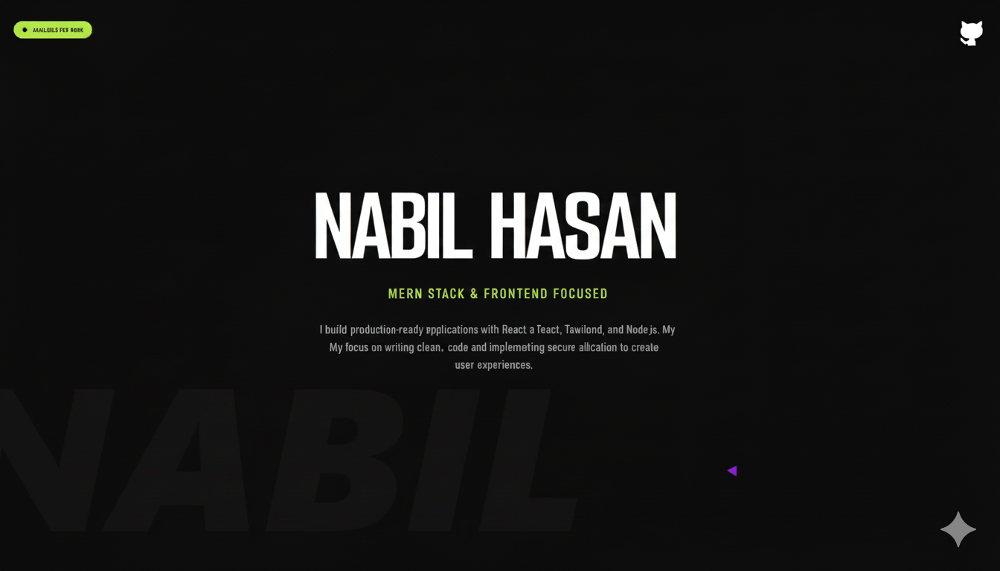

  

  # Nabil Hasan Sopno
  ###  Frontend Engineer | MERN Stack Developer

  
  

---

### Professional Overview
Dedicated Frontend Developer specializing in bridging high-end design systems with scalable architecture. Expert in the MERN stack with a strong emphasis on building fluid user interfaces, performance optimization, and clean micro-interaction ecosystems.

* **Current Focus:** Engineering high-scale B2B SaaS infrastructure.
* **Core Competencies:** Interactive UI design, performance optimization, dynamic animation ecosystems, state management.
* **Specialization:** Deep exploration of Next.js Server Components and Partial Prerendering (PPR).

---

### Technical Skills

| Category | Technologies |
| :--- | :--- |
| **Frontend Frameworks** | React.js, Next.js, JavaScript (ES6+), TypeScript |
| **UI & Motion** | GSAP, Framer Motion, Lenis Smooth Scroll, Tailwind CSS, shadcn/ui |
| **Backend & Databases** | Node.js, Express.js, MongoDB, RESTful API Architecture |
| **Tools & Infrastructure** | Git, Postman, Vercel, Figma |

---

### Engineering Activity & Performance

  

 

  
  

---

### Contact Information

* **Portfolio:** [nabilhasan-05a8a4.netlify.app](https://nabilhasan-05a8a4.netlify.app)
* **Email:** [nabiltalukderbd@gmail.com](mailto:nabiltalukderbd@gmail.com)
* **LinkedIn:** [linkedin.com/in/nabil-hasan-sopno](https://www.linkedin.com/in/nabil-hasan-sopno)

 

  Copyright 2026 Nabil Hasan Sopno. All rights reserved.

